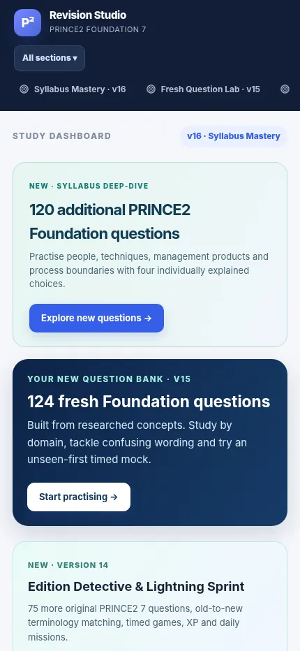
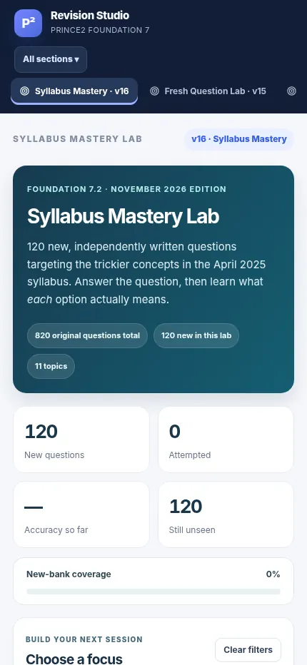
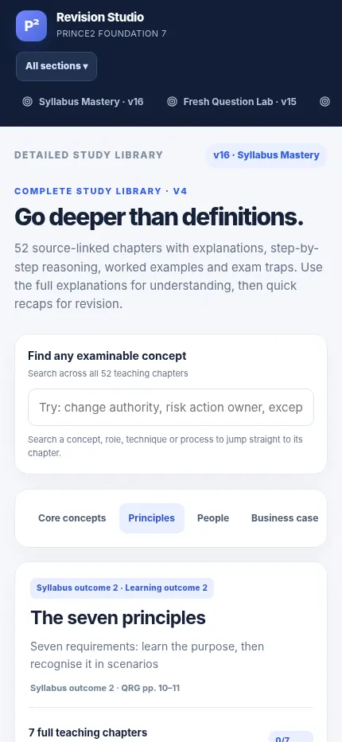

# Just Prince2 Study App

**An offline-first PRINCE2 7 Foundation revision app for Android and the browser.** Study with 820 original multiple-choice questions, adaptive revision, timed mock exams, detailed explanations, learning games and personal progress tracking.

> Independent educational project. Not affiliated with, sponsored by, or endorsed by PeopleCert or PRINCE2. PRINCE2 is a registered trademark of its respective owner.

## Screenshots

These are actual mobile-sized screenshots of the public edition.

| Study dashboard | Syllabus Mastery Lab | Study library |
|:--:|:--:|:--:|
|  |  |  |

## Download and run

**Android:** [Download the installable APK](downloads/Just-Prince2-Study-App-v16-public.apk) (public edition). On Android, open the APK in Downloads and approve installation from that source if prompted. This edition has a separate Android application ID, so it installs **alongside** earlier private Revision Studio versions.

**Browser:** Open [index.html](index.html) in a modern browser. All independent lessons and quizzes are bundled in the HTML; no account or network connection is required for practice. Online source links require internet.

> The APK is a test build verified for package structure and cryptographic signature, but has **not yet been installed on a physical Poco F8 Ultra**. Back up your progress before switching versions.

## What it includes

- **820 independently authored PRINCE2 7 Foundation questions** with topic and syllabus alignment.
- **20-, 30-, 40- and 60-question mock exams**; the official-format simulation has 60 questions in 60 minutes.
- **Detailed study lessons** covering the PRINCE2 principles, people, practices, processes and project context.
- **Answer explanations**, targeted wrong-answer review, terminology comparisons and links back to study topics.
- **Games** including matching, quick-fire questions and decision challenges, plus XP and achievements.
- **Personal study coach** based on quiz history, with a focus on unseen questions.
- **Offline, on-device progress storage** and progress export/import; no login or analytics service.

The app is a study aid, not an official exam or a guarantee of a pass. The genuine Foundation exam has 60 multiple-choice questions, 60 minutes and a 60% pass mark. Shorter mock exams are practice variants.

## Copyright, sources and public/private editions

The **public GitHub edition deliberately does not redistribute** licensed PeopleCert materials, training workbooks, PDF page images, extracted document text, or third-party sample examination questions. Those assets were supplied for private study and are not included here. Instead, the Documents area links to official and independent external sources.

The **820-question independent bank** and original learning UI remain available. The separate source-PDF viewer in prior private APKs does not have bundled document files in this public edition.

Primary reference: PeopleCert *PRINCE2 Project Management Foundation* syllabus, v7.2 (April 2025). Use your authorized training materials to confirm all examined terminology.

## Repository layout

```text
index.html                               Offline browser app and original study content
screenshots/                             Real mobile-sized UI captures
downloads/Just-Prince2-Study-App-v16-public.apk  Signed public-edition Android APK
android/                                 Android Studio / Gradle project for rebuilding
README.md                                This guide
```

## Build from source

The standalone app is a single HTML file. The Android Studio project under `android/` wraps this HTML in a WebView (Java), with DOM storage and JavaScript enabled. Copy the root `index.html` to `android/app/src/main/assets/index.html` before building, or use the included Gradle task. Build an APK with `gradle assembleDebug` from `android/` using Android Studio or an installed Android SDK.

The downloadable APK was built from the same public HTML and signed with a *separate public-edition key*. Rebuilding with your own key produces a different signing identity. Android will not update an existing installation unless the signing certificate matches.

## Repository description

**Just Prince2 Study App — offline-first PRINCE2 7 Foundation study app with 820 original practice questions, timed mocks, explanations, adaptive revision and interactive games for Android and the web.**

---

Feedback and feature ideas are welcome through GitHub Issues.